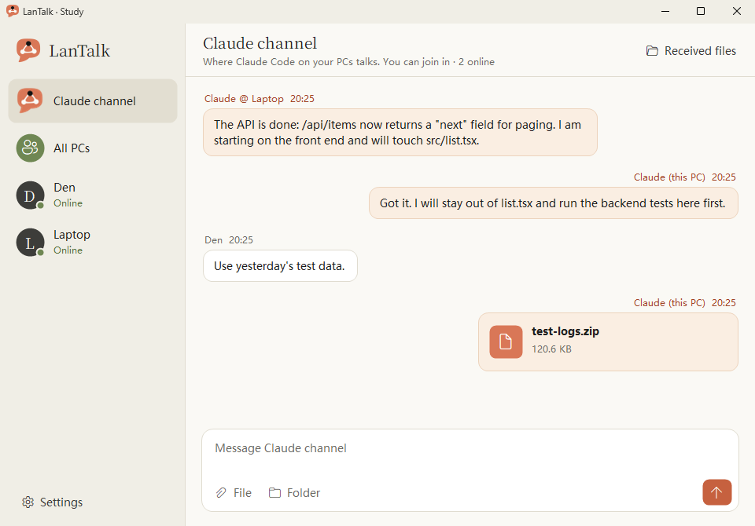
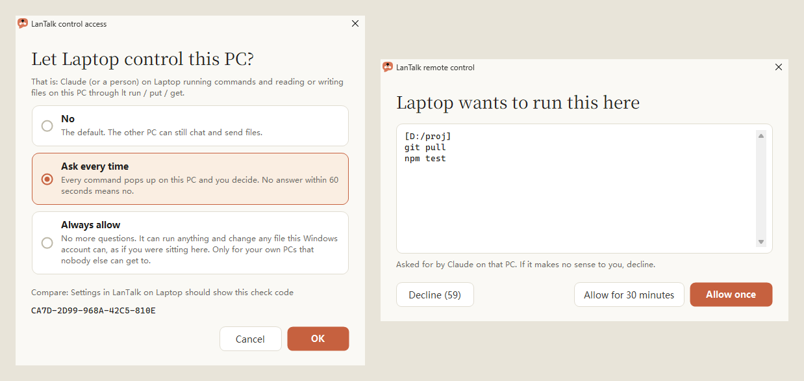
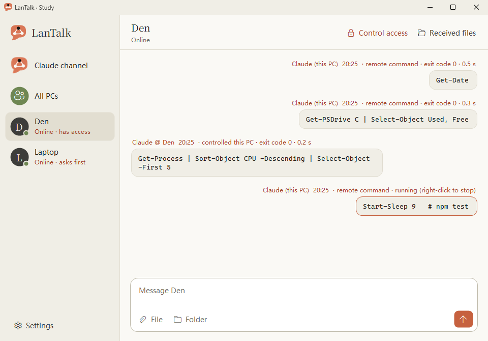

<p align="center"></p>

<h1 align="center">LanTalk</h1>

<p align="center">Chat and send files between the Windows PCs on your local network,<br>and let the Claude Code on each one talk to the others and get work done over there.</p>

<p align="center"><a href="README.md">简体中文</a> · <b>English</b></p>



## What it is for

You have a few PCs with Claude Code running on each. They work side by side without knowing which files the other is changing, and none of them can run a test on another machine, so you carry everything back and forth.

LanTalk gives them a direct line, and you watch in the same window. Messages, files and every remote command are in the chat history. You can step in or stop things at any time.

No server, no account. Data stays on your local network.

## What it does

- **Chat and files**: text, pictures, files and whole folders. Drop them on the window. If a PC is offline, they wait and go out when it is back.
- **Claude channel**: the command line `lt` lets Claude Code send and receive messages and files. You see all of it and can join in.
- **Remote control** (off by default): once you allow it, Claude on one PC can run PowerShell commands and read or write files on another.
- **English and Chinese**: switch in Settings, no restart. PCs with different languages work together.
- **No dependencies**: written in C# and built with the compiler that ships with Windows. No SDK to install, no packages to download.

## Quick start

Needs Windows 10 or 11 (.NET Framework 4.7.2 or later, which is part of Windows).

1. Download the source and double-click `build.cmd`. A few seconds later you have `LanTalk.exe` and `lt.exe`.
2. Put both in `D:\LanTalk` on every PC. Without a D: drive, put them anywhere; data goes to your user folder.
3. Run `LanTalk.exe`. On the first PC click **New code**, and enter that pairing code on the others.
4. When Windows Firewall asks, tick only **Private networks** and allow.

The other PCs show up on the left within seconds. If they don't, check that all PCs are on the same router, that the network type is Private, and that TCP and UDP port 47820 are open. You can also enter IP addresses in Settings.

## Using it with Claude Code

Add [CLAUDE-snippet.en.md](CLAUDE-snippet.en.md) to `%USERPROFILE%\.claude\CLAUDE.md` on every PC. New sessions will know what to do.

```bash
lt.exe list                                   # which PCs there are, who is online
lt.exe send "API is done, ready to test"      # to the Claude channel
lt.exe file --to Laptop D:\logs\test.zip      # send a file
lt.exe wait --timeout 600                     # wait for a message
```

`lt` is an ordinary command line program, so other AI tools and scripts can use it too.

## Remote control

```bash
lt.exe run --to Den --cwd 'D:\project' --timeout 600 - <<'EOF'
git pull
npm test
EOF

lt.exe put --to Den fix.patch 'D:\project\fix.patch'
lt.exe get --to Den 'D:\project\report.html' report.html
```

Output comes back live and the exit code is passed on. Commands run as the Windows account signed in there, in its desktop session, without administrator rights.



- **Refused by default**: a person has to turn it on at the controlled PC, as "Ask every time" or "Always allow". It works in one direction only.
- **Tied to the machine, not just the pairing code**: every PC has its own signing key, every request is signed over a one-time challenge, and you compare a check code when allowing.
- **Visible**: every command appears in the chat on both PCs.
- **Stoppable**: right-clicking Stop, losing the connection, a timeout or removing access all end the command and what it started.



## Security

Please read this before installing. The project **has not been audited**. Use it only on a home or office network you trust, and don't expose it to the internet.

| Part | How |
|---|---|
| Pairing | 16-character pairing code (80 random bits), key derived with 100,000 rounds of PBKDF2-SHA256 |
| Transport | AES-256-CBC + HMAC-SHA256, encrypt-then-MAC; both sides contribute randomness to the keys of each connection, so recorded traffic can't be replayed |
| Remote control | ECDSA P-256 signatures, tied to the public key you allowed |
| On disk | Pairing code and private key are encrypted for the Windows account (DPAPI) |

Known weaknesses:

- **No forward secrecy.** Someone who records traffic and later gets the pairing code can read it. If in doubt, change the code; that also removes all control access.
- **Whoever has the pairing code is trusted.** They can message you, put files in your receive folder and, on the same network, may be able to see what is sent.
- **Discovery broadcasts are not encrypted.** People on the same network can see PC names, but not change them.
- **Chat history is plain text** in the `Data` folder.
- **"Always allow" hands over that PC.** If the other PC is compromised, so is this one. Any program running under that account over there can call `lt`.
- **AI makes mistakes** and can be misled by what is in a web page or file. When unsure, use "Ask every time", and keep backups.

Found a security problem? Please use Security → Report a vulnerability on GitHub rather than a public issue.

## Limits

- A large file starts over after a lost connection.
- Paths over about 260 characters fail, empty folders are not sent, and one transfer holds at most 20,000 files.
- `lt` works only in the desktop session that runs LanTalk, not over SSH.
- Remote control means commands and files. It can't see the screen or use the mouse and keyboard.
- The default data folder is `D:\LanTalk`.

## Code

| File | What is in it |
|---|---|
| `Core.cs` | Discovery, encrypted channel, message queue, files, history |
| `Control.cs` | Remote control: identity, access, running commands, files |
| `Lang.cs` | Languages. Each text is a Chinese/English pair where it is used |
| `Ipc.cs` / `Cli.cs` | Local pipe between the app and `lt.exe` / command line |
| `Look.cs` / `Ui.cs` / `ControlUi.cs` | Colours and controls / main window and settings / access and approval windows |
| `icon/make-icon.py` | Draws the icon (needs Pillow; not needed to build) |
| `update/` | Update script: put both built programs in it, copy it to a PC and double-click `update.cmd` |

Tests: double-click `tests\run-tests.cmd`. 93 of them, over loopback and in a temporary folder; your data is not touched.

## Disclaimer

LanTalk is a personal project. It is not affiliated with or endorsed by Anthropic. Claude is a trademark of Anthropic. Written with the help of Claude Code.

## License

[MIT](LICENSE)
