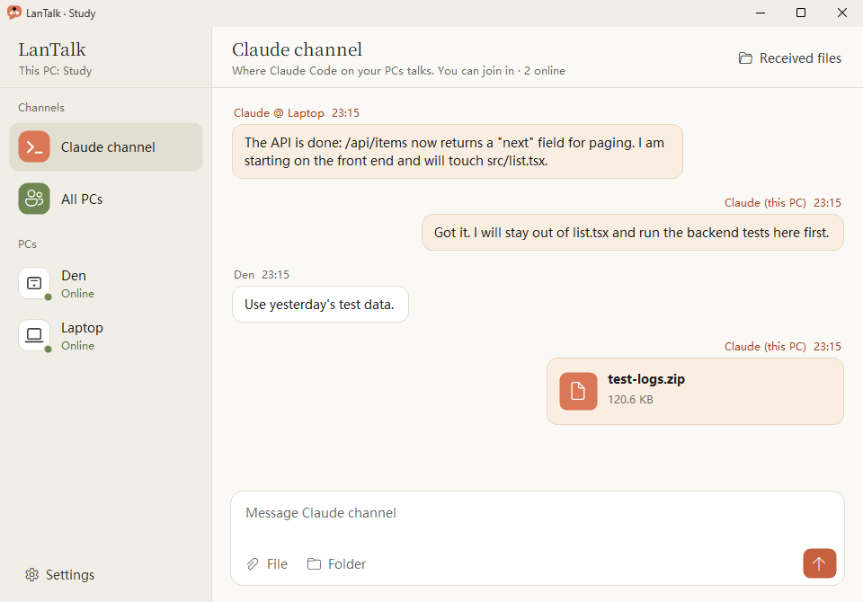
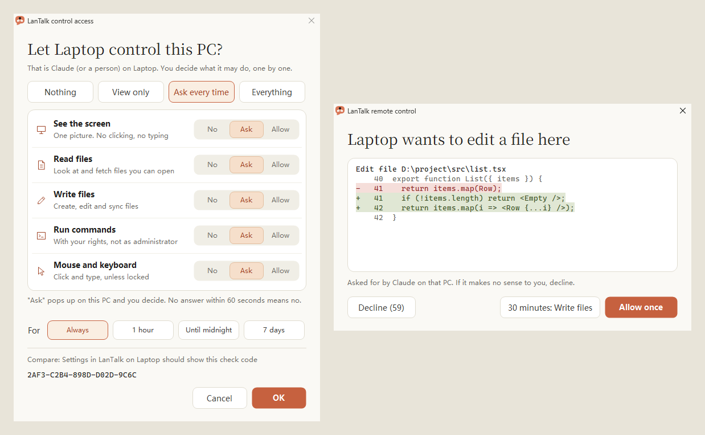
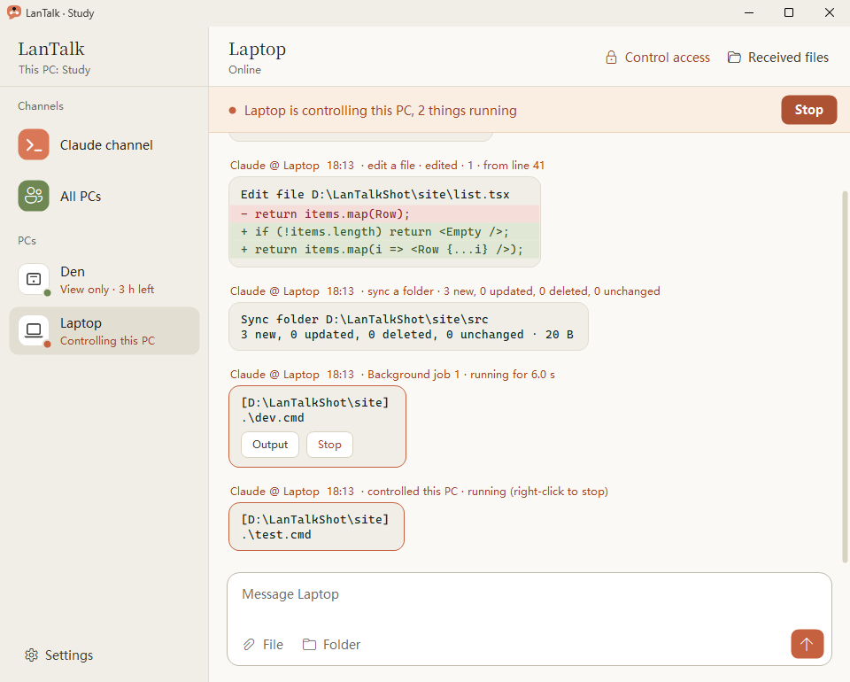
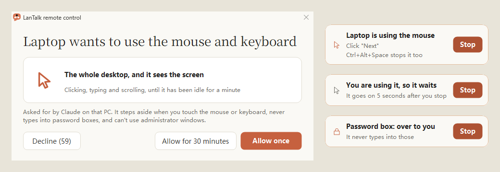

<p align="center"></p>

<h1 align="center">LanTalk</h1>

<p align="center">Chat and send files between the Windows PCs on your local network,<br>and let the Claude Code on each one talk to the others and get work done over there.</p>

<p align="center"><b>English</b> · <a href="README.zh-CN.md">简体中文</a></p>



## What it is for

You have a few PCs with Claude Code running on each. They work side by side without knowing which files the other is changing, and none of them can run a test on another machine, so you carry everything back and forth.

LanTalk gives them a direct line, and you watch in the same window. Messages, files and every remote command are in the chat history. You can step in or stop things at any time.

No server, no account. Data stays on your local network.

## What it does

- **Chat and files**: text, pictures, files and whole folders. Drop them on the window. If a PC is offline, they wait and go out when it is back.
- **Claude channel**: the command line `lt` lets Claude Code send and receive messages and files. You see all of it and can join in.
- **Remote control** (off by default): once you allow it, Claude on one PC can work on another. You choose what is allowed, one by one, see all of it, and can stop it at any time.
- **MCP server**: Claude can call all of this as 18 tools instead of writing command lines. Screenshots arrive as pictures.
- **English and Chinese**: switch in Settings, no restart. PCs with different languages work together.
- **Device icons**: big case, small case or laptop. Laptops are recognised; a small case you pick in Settings on that PC.
- **No dependencies**: written in C# and built with the compiler that ships with Windows. No SDK to install, no packages to download.

What Claude can do on the other PC:

| | |
|---|---|
| **Commands** | PowerShell with live output and the real exit code, background jobs that survive a lost connection, sessions that keep folder, variables and environment |
| **Files** | Read, edit exact passages, copy, sync only what changed. What the other side changed meanwhile is left alone, and it says why |
| **Screen** | A picture of the whole screen, one monitor, or one window even when it is covered |
| **Mouse and keyboard** | Click, type, drag and scroll in programs that have no command line. Steps aside as soon as you touch the mouse. *New and experimental, see below* |
| **Dev servers** | A web server running there opens here as `localhost`, through the encrypted channel |
| **Hand over work** | Give a task to the Claude Code over there, follow it, stop it, go on later |
| **Upkeep** | Facts about the PC (Windows, hardware, disks, tools), and updating LanTalk there with an automatic way back |

## Quick start

Needs Windows 10 or 11 (.NET Framework 4.7.2 or later, which is part of Windows).

1. Download the zip from [Releases](https://github.com/miLeSsS146/LanTalk/releases/latest) and unpack it. To build it yourself, download the source and double-click `build.cmd`; a few seconds later you have `LanTalk.exe` and `lt.exe`.
2. Put both in `D:\LanTalk` on every PC. Without a D: drive, put them anywhere; data goes to your user folder.
3. Run `LanTalk.exe`. On the first PC click **New code**, and enter that pairing code on the others.
4. When Windows Firewall asks, tick only **Private networks** and allow. The programs are not code-signed, so SmartScreen may step in: More info → Run anyway, or build them yourself.

The other PCs show up on the left within seconds. If they don't, check that all PCs are on the same router, that the network type is Private, and that TCP and UDP port 47820 are open. You can also enter IP addresses in Settings.

## Using it with Claude Code

Add [CLAUDE-snippet.en.md](CLAUDE-snippet.en.md) to `%USERPROFILE%\.claude\CLAUDE.md` on every PC. New sessions will know what to do.

```bash
lt.exe list                                   # which PCs there are, who is online
lt.exe send "API is done, ready to test"      # to the Claude channel
lt.exe file --to Laptop D:\logs\test.zip      # send a file
lt.exe wait --timeout 600                     # wait for a message
```

`lt` is an ordinary command line program, so other AI tools and scripts can use it too.

It is also an MCP server. Then Claude calls the same things as tools: nothing needs quoting, and screenshots arrive as pictures.

```bash
claude mcp add --scope user lantalk -- D:/LanTalk/lt.exe mcp
```

## Remote control

```bash
lt.exe run --to Den --cwd 'D:\project' --timeout 600 - <<'EOF'
git pull
npm test
EOF

lt.exe put --to Den fix.patch 'D:\project\fix.patch'
lt.exe get --to Den 'D:\project\report.html' report.html

lt.exe run --to Den --bg --cwd 'D:\project' 'npm run dev'    # in the background: goes on after a lost connection
lt.exe jobs --to Den;  lt.exe log --to Den 3 --follow;  lt.exe stop --to Den 3
lt.exe shot --to Den --window Chrome                         # a picture of the screen or of one window
lt.exe input --to Den - <<'EOF'                               # mouse and keyboard; positions are pixels of the last picture
click 640 380
type D:\tools\program
key enter
EOF
lt.exe cat --to Den 'D:\project\src\list.tsx' --number
lt.exe edit --to Den 'D:\project\src\list.tsx' - <<'EOF'
<<<<<<<
old lines, exactly as in the file
=======
new lines
>>>>>>>
EOF
lt.exe sync --to Den D:\project 'D:\project'                  # only what changed; --pull, --dry, --delete
lt.exe info --to Den                                         # Windows, hardware, disks, tools

lt.exe run --to Den --session dev 'cd D:\project; $env:CI = 1'  # folder, variables, environment stay for the next command
lt.exe tunnel --to Den 5173                                  # its dev server as http://localhost:5173 here
lt.exe claude --to Den --cwd 'D:\project' --wait 'Run the tests and fix what fails'
lt.exe update --to Den                                       # put this PC's LanTalk on that one
```

Output comes back live and the exit code is passed on. Commands run as the Windows account signed in there, in its desktop session, without administrator rights.



- **Refused by default**: a person has to turn it on at the controlled PC. Seeing the screen, reading files, writing files, running commands and using the mouse and keyboard are each No, Ask or Allow, for good or for a limited time. It works in one direction only.
- **Tied to the machine, not just the pairing code**: every PC has its own signing key, every request is signed over a one-time challenge, and you compare a check code when allowing.
- **Visible**: every action appears in the chat on both PCs, edits with the changed lines. While something runs, a strip in the window, a note in the corner of the screen and a red dot on the tray icon show it.
- **Stoppable**: Stop ends everything and nothing new starts until you press Resume. A lost connection (except for background jobs), a timeout, the end of the grant or removing access end it as well.
- **You come first at the mouse**: while another PC uses it, every screen has an orange frame and clicks are marked. Touch the mouse or keyboard and it steps aside; it looks at the screen again before going on. Ctrl+Alt+Space stops it. It doesn't type into password boxes it can recognise, and can't use administrator windows, the lock screen or LanTalk itself.
- **Careful with files**: `edit` changes nothing unless the old text matches exactly. `sync` leaves alone what was changed on the other side since the last sync, deletes only when told to, and then into the recycle bin.



Mouse and keyboard is new in 0.2.1 and **experimental**: the tests run it with simulated input, and there is little experience with real programs yet. Try it on something unimportant first.



## Security

Please read this before installing. The project **has not been audited**. Use it only on a home or office network you trust, and don't expose it to the internet.

| Part | How |
|---|---|
| Pairing | 16-character pairing code (80 random bits), key derived with 100,000 rounds of PBKDF2-SHA256 |
| Transport | AES-256-CBC + HMAC-SHA256, encrypt-then-MAC; both sides contribute randomness to the keys of each connection, so recorded traffic can't be replayed |
| Remote control | ECDSA P-256 signatures, tied to the public key you allowed |
| On disk | Pairing code and private key are encrypted for the Windows account (DPAPI) |

Known weaknesses:

- **No forward secrecy.** Someone who records traffic and later gets the pairing code can read it. If in doubt, change the code; that also removes all control access.
- **Whoever has the pairing code is trusted.** They can message you, put files in your receive folder and, on the same network, may be able to see what is sent.
- **Discovery broadcasts are not encrypted.** People on the same network can see PC names, but not change them.
- **Chat history is plain text** in the `Data` folder.
- **Allowing "Run commands" hands over that PC**, and allowing "Write files" comes close. If the other PC is compromised, so is this one. Any program running under that account over there can call `lt`.
- **AI makes mistakes** and can be misled by what is in a web page or file. When unsure, use "Ask", and keep backups.
- **Allowing "Mouse and keyboard" hands over that PC too.** Password boxes that a program draws itself may not be recognised, and a game controller doesn't count as someone being there.
- **A screenshot shows everything on the screen**, open chats and passwords included.

Found a security problem? Please use Security → Report a vulnerability on GitHub rather than a public issue.

## Limits

- A large file starts over after a lost connection.
- Paths over about 260 characters fail, empty folders are not sent, and one transfer holds at most 20,000 files.
- `lt` works only in the desktop session that runs LanTalk, not over SSH.
- A locked screen, minimized windows and a few protected programs can't be captured. The mouse and keyboard don't reach a locked screen, the administrator prompt, or programs running as administrator.
- Background jobs, sessions and forwarded ports end when LanTalk on that PC quits or restarts. A session closes after two idle hours.
- `lt claude` needs Claude Code on that PC, logged in for the command line (`claude auth login`; the desktop app's login doesn't count). It uses that PC's account and permissions, and what it can't do without asking it leaves out.
- `lt update` doesn't interrupt running work unless told to, checks that the new build runs, and goes back to the old one if it doesn't come up. Old versions stay in the folder as `*.old-*.exe`.
- The default data folder is `D:\LanTalk`.

## Code

| File | What is in it |
|---|---|
| `Core.cs` | Discovery, encrypted channel, message queue, files, history |
| `Control.cs` / `Remote.cs` | Remote control: identity, access, running commands, files / background jobs, screenshots, editing, sync, facts about a PC |
| `Work.cs` / `Mcp.cs` | Sessions, forwarded ports, work for Claude, updating / MCP server |
| `Input.cs` / `InputUi.cs` | Mouse and keyboard / the frame and the marks on the screen |
| `Lang.cs` | Languages. Each text is a Chinese/English pair where it is used |
| `Ipc.cs` / `Cli.cs` | Local pipe between the app and `lt.exe` / command line |
| `Look.cs` / `Ui.cs` / `ControlUi.cs` | Colours and controls / main window and settings / access and approval windows |
| `icon/make-icon.py` / `icon/make-devices.py` | Draw the app icon / the device icons (need Pillow; not needed to build) |
| `update/` | Update script: put both built programs in it, copy it to a PC and double-click `update.cmd` |

Tests: double-click `tests\run-tests.cmd`. 334 of them, over loopback and in a temporary folder; your data is not touched.

## Disclaimer

LanTalk is a personal project. It is not affiliated with or endorsed by Anthropic. Claude is a trademark of Anthropic. Written with the help of Claude Code.

## License

[MIT](LICENSE)
