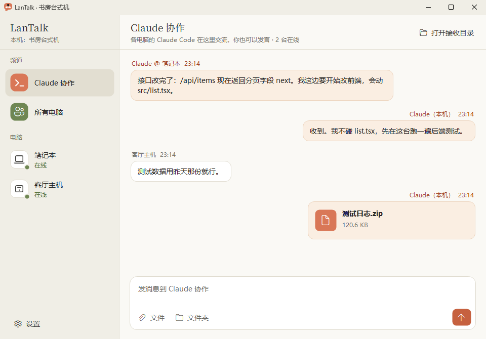
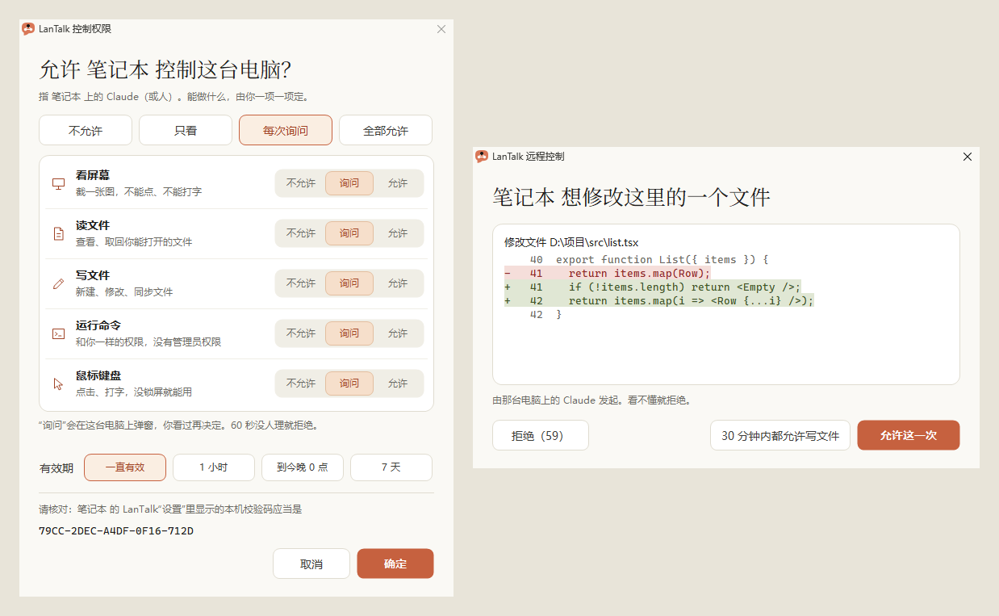
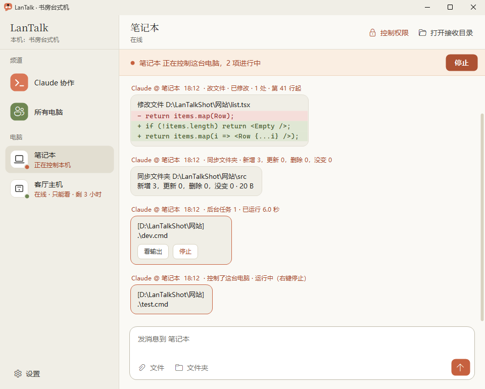
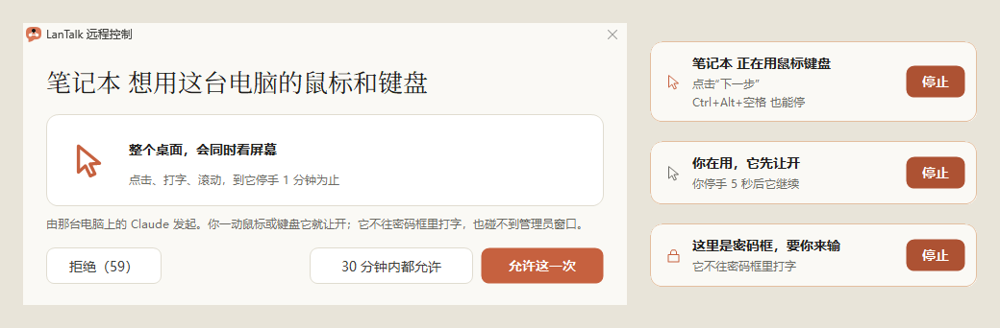

<p align="center"></p>

<h1 align="center">LanTalk</h1>

<p align="center">让局域网里的几台 Windows 电脑互相聊天、传文件，<br>也让每台电脑上的 Claude Code 能彼此沟通、到对方那台上干活。</p>

<p align="center"><a href="README.md">English</a> · <b>简体中文</b></p>



## 它解决什么问题

你有几台电脑，每台上都开着 Claude Code。它们各干各的，不知道对方在改哪个文件，也没法去另一台上跑个测试，只能靠你来回搬运。

LanTalk 给它们一条直通的线路，你也在同一个窗口里看着。消息、文件、每一条远程命令都摆在聊天记录里，随时能插话或叫停。

没有服务器，没有账号，数据只在你的局域网里走。

## 能做什么

- **聊天和传文件**：文字、图片、文件、整个文件夹，拖进窗口就发。对方不在线会排队，上线后自动送达。
- **Claude 协作频道**：命令行 `lt` 让 Claude Code 收发消息和文件，你在窗口里看得到，也能发言。
- **远程控制**（默认关闭）：授权之后，一台电脑上的 Claude 可以到另一台上干活。能做哪几样，由你一项一项定；每一步都看得见，随时能停。
- **MCP 服务器**：上面这些都能当工具直接调用，一共 18 个，不用拼命令行，截图直接就是图片。
- **中英双语**：在设置里切换，立即生效。语言不同的电脑之间也能正常配合。
- **设备图标**：大机箱、小机箱、笔记本。笔记本会自动识别；小机箱在那台电脑的设置里选。
- **零依赖**：C# 写成，用 Windows 自带的编译器就能编译，不用装 SDK，不用联网下载任何包。

Claude 到另一台电脑上能做这些：

| | |
|---|---|
| **运行命令** | PowerShell，输出实时传回，退出码原样返回；后台任务断线也继续；会话能记住目录、变量和环境 |
| **文件** | 读文件、精确改其中一段、传文件、只同步有变化的。对方同时改过的不会盖掉，还会说明原因 |
| **看屏幕** | 截整个屏幕、某一台显示器，或某个窗口（被挡住也行） |
| **鼠标键盘** | 在没有命令行的软件里点击、打字、拖动、滚动。你一动鼠标它就让开。*新功能，试验阶段，见下文* |
| **开发服务器** | 那边跑的网页，本机用 `localhost` 就能打开，走加密通道 |
| **派活** | 把任务交给那台的 Claude Code，能看进展、停止、接着派 |
| **维护** | 查看系统、硬件、磁盘、装了哪些工具；更新那台的 LanTalk，起不来会自动换回 |

## 快速开始

需要 Windows 10 / 11（.NET Framework 4.7.2 以上，系统自带）。

1. 从 [Releases](https://github.com/miLeSsS146/LanTalk/releases/latest) 下载 zip 并解压。想自己编译的话，下载源码双击 `build.cmd`，几秒后得到 `LanTalk.exe` 和 `lt.exe`。
2. 把这两个文件放到每台电脑的 `D:\LanTalk`（没有 D 盘也可以放别处，数据会存到用户目录）。
3. 运行 `LanTalk.exe`。第一台点“生成新的”得到配对码，其他电脑填同一个。
4. Windows 防火墙弹窗时，只勾选“专用网络”并允许。程序没有代码签名，SmartScreen 可能会拦一下，点“更多信息 → 仍要运行”；不放心就自己编译。

几秒后左侧会出现其他电脑。更多用法见 [使用说明](使用说明.md)。

## 让 Claude Code 用起来

把 [CLAUDE协作片段.md](CLAUDE协作片段.md) 的内容加进每台电脑的 `%USERPROFILE%\.claude\CLAUDE.md`，新开的会话就会用了。

```bash
lt.exe list                                   # 有哪些电脑、谁在线
lt.exe send "接口改完了，可以联调"              # 发到 Claude 协作频道
lt.exe file --to 笔记本 D:\logs\test.zip       # 传文件
lt.exe wait --timeout 600                     # 等新消息
```

`lt` 是普通命令行程序，其他能执行命令的 AI 工具或脚本同样可以用。

它也可以当 MCP 服务器用，Claude 直接把这些当工具调用：不用管引号转义，截图直接就是图片。

```bash
claude mcp add --scope user lantalk -- D:/LanTalk/lt.exe mcp
```

## 远程控制

```bash
lt.exe run --to 客厅主机 --cwd 'D:\项目' --timeout 600 - <<'EOF'
git pull
npm test
EOF

lt.exe put --to 客厅主机 fix.patch 'D:\项目\fix.patch'
lt.exe get --to 客厅主机 'D:\项目\report.html' report.html

lt.exe run --to 客厅主机 --bg --cwd 'D:\项目' 'npm run dev'    # 放后台，断线也继续
lt.exe jobs --to 客厅主机;  lt.exe log --to 客厅主机 3 --follow;  lt.exe stop --to 客厅主机 3
lt.exe shot --to 客厅主机 --window Chrome                     # 截全屏或某个窗口
lt.exe cat --to 客厅主机 'D:\项目\src\list.tsx' --number
lt.exe edit --to 客厅主机 'D:\项目\src\list.tsx' - <<'EOF'
<<<<<<<
原文，要和文件里完全一样
=======
新文
>>>>>>>
EOF
lt.exe input --to 客厅主机 - <<'EOF'                          # 鼠标键盘；坐标是最近一张截图里的像素
click 640 380
type D:\工具\某软件
key enter
EOF
lt.exe sync --to 客厅主机 D:\项目 'D:\项目'                    # 只传有变化的；可加 --pull、--dry、--delete
lt.exe info --to 客厅主机                                     # 系统、硬件、磁盘、装了哪些工具

lt.exe run --to 客厅主机 --session dev 'cd D:\项目; $env:CI = 1'  # 目录、变量、环境留到下一条命令
lt.exe tunnel --to 客厅主机 5173                              # 那边的开发服务器，本机用 http://localhost:5173 打开
lt.exe claude --to 客厅主机 --cwd 'D:\项目' --wait '跑一遍测试，修好失败的'
lt.exe update --to 客厅主机                                   # 把本机的 LanTalk 装到那台
```

输出实时传回，退出码原样返回。命令以对方当前的 Windows 账户、在对方的桌面会话里运行，没有管理员权限。



- **默认拒绝**：要由人在被控制的那台电脑上打开。看屏幕、读文件、写文件、运行命令、鼠标键盘分别选“不允许 / 询问 / 允许”，可以一直有效，也可以限时。权限是单向的。
- **认机器，不只认配对码**：每台电脑有自己的签名密钥，每个请求都对一次性随机数签名，授权时要核对校验码。
- **看得见**：每一次操作都出现在两台电脑的聊天里，改文件会写明改了哪几行。进行中时，窗口顶部有横条、屏幕右下角有浮条、托盘图标有红点。
- **停得下**：按“停止”会停掉全部，你点“恢复”之前不能再开始新的。断线（后台任务除外）、超时、授权到期、收回权限也都会停。
- **用鼠标时人优先**：另一台在用鼠标键盘时，每个屏幕都有橙色边框，点过的地方有圆圈。你一动鼠标或键盘它就让开，重新看过屏幕才接着做；按 Ctrl+Alt+空格 就停。认得出的密码框它不输入，管理员窗口、锁屏和 LanTalk 自己的窗口它操作不了。
- **不乱动文件**：`edit` 的原文对不上就什么都不改；`sync` 不碰对方在上次同步后改过的文件，要删除得明说，而且进回收站。



鼠标键盘是 0.2.1 的新功能，还在**试验阶段**：测试用的是模拟输入，在真实软件里用得还少。先拿不重要的东西试。



## 安全说明

请在装之前读完这一节。这个项目**没有经过专业的安全审计**，只适合放在你自己信任的家庭或办公局域网里，不要暴露到公网。

| 部分 | 做法 |
|---|---|
| 配对 | 16 位配对码（80 位随机），PBKDF2-SHA256 十万次派生密钥 |
| 传输 | AES-256-CBC + HMAC-SHA256，先加密后认证；双方随机数派生每次连接的密钥，录下的流量不能重放 |
| 远程控制 | ECDSA P-256 签名，绑定授权时的公钥 |
| 本机存储 | 配对码和私钥用 Windows 账户加密（DPAPI）保存 |

已知的不足：

- **没有前向保密**。有人录下流量、之后又拿到配对码，就能解开旧内容。怀疑泄露就换配对码，换码会清空所有控制权限。
- **有配对码就等于被信任**，能给你发消息、把文件存进接收目录，接入同一局域网时也可能看到通信内容。
- **发现广播没有加密**，同一局域网里的人能看到电脑名（但改不了）。
- **聊天记录是明文**，存在 `Data` 文件夹里。
- **允许“运行命令”等于交出这台电脑**，允许“写文件”也差不多：对方失守，这台也就失守。而且对方电脑上以那个账户运行的任何程序，都可以调用 `lt`。
- **AI 会犯错，也可能被网页或文件里的内容误导**。拿不准就用“询问”，并留好备份。
- **允许“鼠标键盘”也等于交出这台电脑**。软件自己画的密码框可能认不出来，用手柄不算有人在用。
- **截图会截到屏幕上的一切**，包括打开的聊天和密码。

发现安全问题，请用 GitHub 的 Security → Report a vulnerability 私下告知，不要直接发 Issue。

## 已知限制

- 大文件断线后从头重传，没有断点续传。
- 完整路径超过约 260 个字符的文件会失败；空文件夹不会传过去；一次最多 20000 个文件。
- `lt` 只能在运行 LanTalk 的桌面会话里用，不能经 SSH 调用。
- 锁屏、最小化的窗口和少数受保护的程序截不到。锁屏、管理员确认框和以管理员身份运行的程序，鼠标键盘操作不了。
- 后台任务、会话、端口转发会随那台电脑上的 LanTalk 退出或重启而结束。会话两小时不用自动关。
- `lt claude` 要那台电脑装了 Claude Code，并且命令行登录过（`claude auth login`，桌面版的登录不算）。用的是那台的账号和权限，没有权限的操作会跳过。
- `lt update` 不打断正在跑的任务（除非明说），先确认新版能运行，起不来就自动换回。旧版留在文件夹里，名字是 `*.old-*.exe`。
- 默认数据目录是 `D:\LanTalk`。

## 代码结构

| 文件 | 内容 |
|---|---|
| `Core.cs` | 发现、加密通道、消息队列、收发文件、历史记录 |
| `Control.cs` / `Remote.cs` | 远程控制：身份、授权、执行命令、读写文件 / 后台任务、截图、改文件、同步、电脑信息 |
| `Work.cs` / `Mcp.cs` | 会话、端口转发、派活给 Claude、更新 / MCP 服务器 |
| `Input.cs` / `InputUi.cs` | 鼠标键盘 / 屏幕边框和点击标记 |
| `Lang.cs` | 语言。每条文字都在用到的地方中英成对写着 |
| `Ipc.cs` / `Cli.cs` | 程序与 `lt.exe` 之间的本机管道 / 命令行 |
| `Look.cs` / `Ui.cs` / `ControlUi.cs` | 配色与自绘控件 / 主窗口与设置 / 权限与确认窗口 |
| `icon/make-icon.py` / `icon/make-devices.py` | 生成程序图标 / 设备图标（需要 Pillow，编译时不需要） |
| `update/` | 一键更新脚本；把编译好的两个 exe 放进去，拷到目标电脑双击 `update.cmd` |

跑测试：双击 `tests\run-tests.cmd`。334 项，只走本机回环，用临时目录，不碰真实数据。

## 声明

LanTalk 是个人项目，与 Anthropic 没有从属或合作关系，也未获其认可。Claude 是 Anthropic 的商标。代码在 Claude Code 协助下完成。

## 许可

[MIT](LICENSE)
